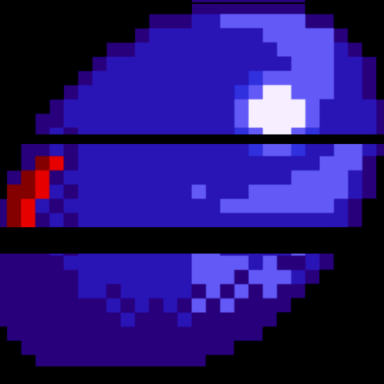
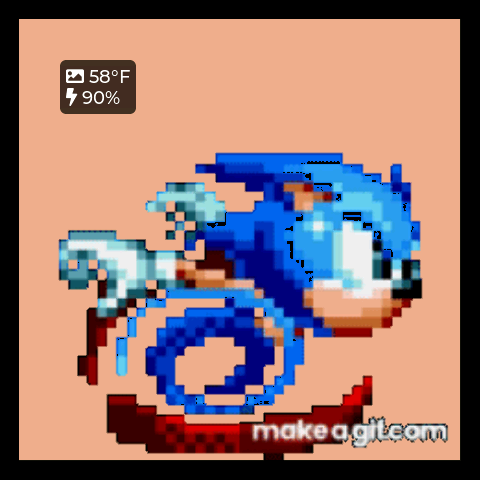
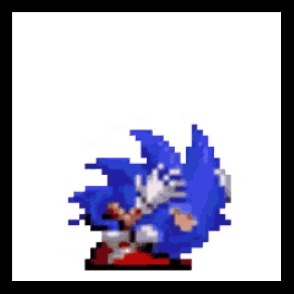
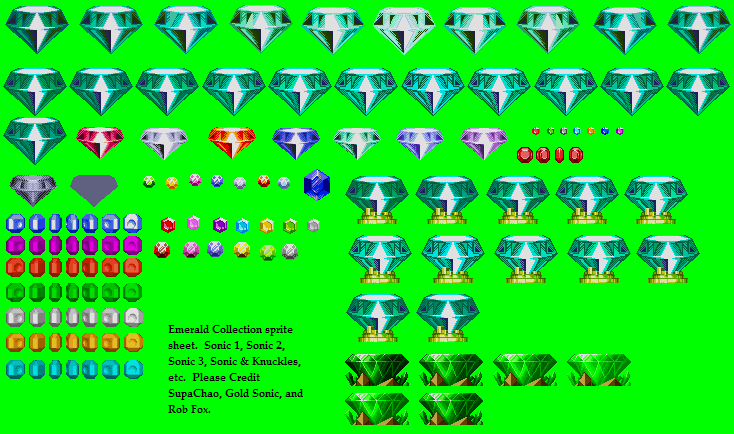
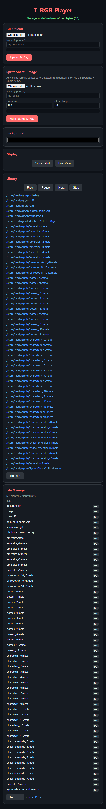
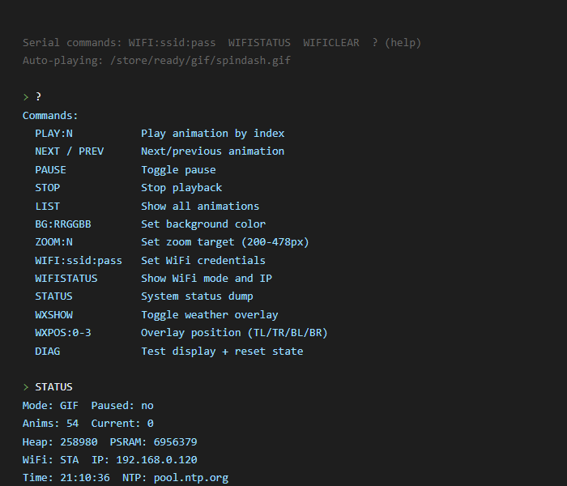

# T-RGB-Player

Custom firmware for the LilyGo T-RGB ESP32-S3 round display. Plays GIF animations and sprite sheets with auto-zoom on a 480x480 round screen. Automatic background removal, weather overlay, web UI, full serial CLI, and dual-core architecture.

<p align="center">
  
  
  
</p>
<p align="center"><em>GIF playback &bull; Sprite animation &bull; Weather overlay</em></p>

## Supported Hardware

| Variant | Size | Touch Driver |
|---------|------|-------------|
| T-RGB 2.1" Half Circle | 480x480 | FT3267 |
| T-RGB 2.1" Full Circle | 480x480 | CST820 |
| T-RGB 2.8" Full Circle | 480x480 | GT911 |

All variants use ST7701S display driver on ESP32-S3R8 (16MB flash, 8MB OPI PSRAM).

## Features

- **GIF playback** with auto-zoom and automatic background removal
- **Sprite sheet playback** with alpha compositing (RGB565+A8)
- **Web UI** for uploads, playback control, screenshot/live view, file management
- **Touch controls** — tap left/right/center for prev/next/pause, long-press for menu
- **On-screen selector menu** with speed control (50-150%)
- **Weather overlay** — toggleable on-screen temp/humidity display, configurable position
- **Weather data** — temperature and humidity via Open-Meteo (free, no API key)
- **NTP time sync** — configurable server and timezone
- **API usage monitoring** — rate-limit tracking via OAuth token
- **SD card storage** with organized directory structure
- **Configurable zoom margin** — keep content off the round display edges
- **Full serial CLI** — complete playback and configuration control over USB serial
- **Dual-core** — network on core 0, display on core 1 (no frame stutter during HTTP)
- **WiFi auto-reconnect** — retries STA connection every 30 seconds in AP mode
- **Companion tool** — BlitHappens sprite editor (see companion repo)

## GIF Background Removal

GIF backgrounds are automatically detected and replaced with the device background color. No manual configuration needed — the firmware samples the rendered frame edges and replaces the dominant background color in real-time.

| Raw GIF (white background) | On device (background removed) |
|---|---|
|  |  |

GIFs where content fills the entire frame (no visible background) are detected automatically and left unmodified.

## Sprite Sheet to Device

Upload any sprite sheet — individual sprites are auto-detected, converted to RGB565+A8 with per-pixel alpha, and played back with auto-zoom on the round display.

| Input sprite sheet | On device (auto-zoomed) |
|---|---|
|  |  |

Use the companion **BlitHappens** editor for row selection, per-frame delay control, and live preview before uploading.

## Build (PlatformIO)

```
pio run                             # compile
pio run -t upload                   # flash via USB
pio device monitor                  # serial monitor (115200 baud)
```

## Build (Arduino IDE)

Board: **ESP32S3 Dev Module**

| Setting | Value |
|---------|-------|
| Flash Size | 16MB |
| PSRAM | OPI PSRAM |
| Partition Scheme | 16M Flash (3M APP/9.9MB FATFS) |
| USB Mode | Hardware CDC and JTAG |
| Upload Mode | UART0 / Hardware CDC |

## First-Time Setup

1. Flash the firmware
2. Connect to the `T-RGB-Player` WiFi AP (password: `12345678`)
3. Open `http://192.168.4.1` in a browser
4. Or send WiFi credentials over serial: `WIFI:your_ssid:your_password`

After connecting to your network, the device's IP is shown on the serial console and via the `WIFISTATUS` serial command.

## Web UI

Access at `http://<device-ip>` once connected to your network.



- **GIF Upload** — select a `.gif`, optionally name it, upload with progress bar
- **Sprite Upload** — select any image (PNG/JPG/WebP), auto-detects sprites, uploads as animation
- **Background Color** — color picker for display background
- **Playback Controls** — prev / pause / next / stop
- **Screenshot / Live View** — grab framebuffer or auto-refresh every 2s
- **Library** — list all stored animations, click to play, see storage usage
- **File Manager** — browse SD card, delete files
- **SD Browser** — full directory listing at `/browse`

## Touch Controls

| Gesture | Action |
|---------|--------|
| Tap left third | Previous animation |
| Tap right third | Next animation |
| Tap center | Pause / resume |
| Long press (2s) | Open selector menu |

The selector menu shows nearby animations, a speed control wheel (50-150%), and a Play All button for continuous cycling.

## Weather Overlay

Toggleable on-screen weather display showing temperature and humidity from Open-Meteo (free, no API key required). Configurable to any corner of the display.


Configure via serial (`WXLOC:lat:lon` to set location, `WXSHOW` to toggle, `WXPOS:0-3` for position) or via the web UI's Display Settings panel.

## Serial Commands (115200 baud)

Full CLI over USB serial with live character echo and backspace. Type `?` for the command list.



| Command | Action |
|---------|--------|
| `PLAY:N` | Play animation by index |
| `NEXT` / `PREV` | Next / previous animation |
| `PAUSE` | Toggle pause |
| `STOP` | Stop playback |
| `LIST` | Show all animations |
| `BG:RRGGBB` | Set background color |
| `ZOOM:N` | Set zoom target (200-478px) |
| `WIFI:ssid:pass` | Set WiFi credentials, reboot |
| `WIFISTATUS` | Show WiFi mode and IP |
| `WIFICLEAR` | Clear WiFi credentials, reboot |
| `DEBUG:area:lvl` | Set debug level (areas: web/api/gfx/all, levels: 0-3) |
| `STATUS` | Full system status dump |
| `TOKEN:<oauth>` | Save API OAuth token to NVS |
| `WXLOC:lat:lon` | Set weather location (latitude:longitude) |
| `NTP:server` | Set NTP server address |
| `TZ:posix` | Set timezone (POSIX TZ string) |
| `TIME` | Show current synced time |
| `WXSHOW` | Toggle weather overlay on/off |
| `WXPOS:0-3` | Weather overlay position (TL/TR/BL/BR) |
| `DIAG` | Test display, reset state |
| `SNAP` | Save framebuffer to SD as `/snap.raw` |

## HTTP API

| Endpoint | Method | Description |
|----------|--------|-------------|
| `/` | GET | Web UI |
| `/api/status` | GET | JSON system status |
| `/api/weather` | GET | JSON weather data |
| `/api/usage` | GET | JSON API usage stats |
| `/api/time` | GET | JSON time/NTP/TZ info |
| `/api/wxset?lat=N&lon=N` | GET | Set weather location |
| `/api/token?t=TOKEN` | GET | Set API OAuth token |
| `/list` | GET | JSON animation list with storage info |
| `/play?i=N` | GET | Play animation by index |
| `/ctrl?a=next\|prev\|pause` | GET | Playback control |
| `/stop` | GET | Stop playback, dim display |
| `/bg?c=RRGGBB` | GET | Set background color |
| `/zoom?t=N` | GET | Set zoom target (200-478px) |
| `/wxoverlay?on=1&pos=N` | GET | Weather overlay toggle + position (0-3) |
| `/del?f=path` | GET | Delete animation |
| `/screenshot` | GET | Framebuffer capture (BMP) |
| `/up/gif` | POST | Upload GIF (multipart) |
| `/up/sprite` | POST | Upload sprite sheet (multipart) |
| `/bootlog` | GET | Boot/SD diagnostic log |
| `/sd/init` | GET | Retry SD card init |
| `/reboot` | GET | Software reboot |
| `/browse` | GET | SD card directory browser |
| `/sdcard/<path>` | GET | Direct SD file access |

## SD Card

- FAT32 formatted (format on PC, not on-device)
- Directory structure:
  ```
  /store/ready/gif/       GIF files
  /store/ready/sprite/    .meta + .frm animation pairs
  ```

## USB Recovery

If the device won't enumerate over USB: hold **BOOT**, press **RST**, release **RST**, release **BOOT**, then upload.

For battery-only operation (no USB), comment out `-DARDUINO_USB_CDC_ON_BOOT=1` in `platformio.ini` and uncomment `-UARDUINO_USB_CDC_ON_BOOT`, or the firmware will block waiting for USB serial.

## Dependencies

| Library | Version |
|---------|---------|
| lvgl | 8.4.0 (v8.x only, NOT v9) |
| SensorLib | >= 0.2.3 |
| TFT_eSPI | 2.5.43 |
| GFX Library for Arduino | 1.5.0 |

## Project Structure

```
T-RGB-Player/
  platformio.ini              PlatformIO config
  boards/
    LilyGo-T-RGB.json         Custom board definition
  src/                        LilyGo display library
    LilyGo_RGBPanel.h/.cpp    Panel driver (ST7701S + touch)
    LV_Helper.h/.cpp           LVGL integration
    utilities.h                Pin definitions
    lv_conf.h                  LVGL configuration
    RGBPanelInit.h             Display init sequences
  examples/
    WiFiGifPlayer/
      WiFiGifPlayer.ino        Main firmware
      page.h                   Embedded web UI (HTML/JS)
```

## Based On

Custom firmware built on the [LilyGo T-RGB](https://github.com/Xinyuan-LilyGO/LilyGo-T-RGB) library (v1.0.5). See `LICENSE-LilyGo` for the upstream MIT license.

## License

MIT License. See [LICENSE](LICENSE).